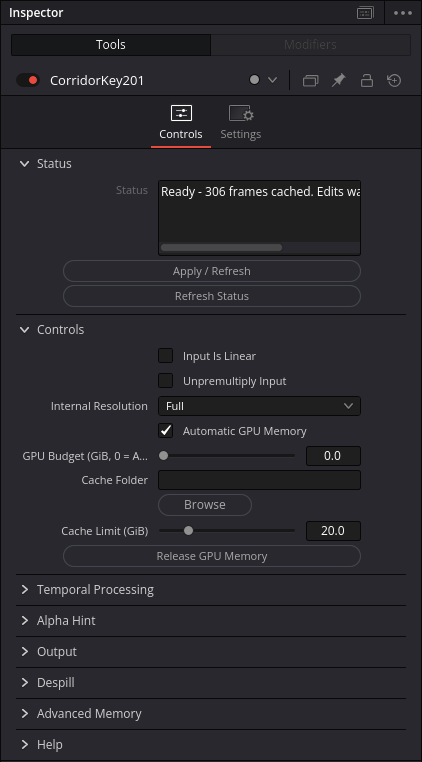

# CorridorKey 2.0 for DaVinci Resolve on Linux

This puts CorridorKey 2.0 inside DaVinci Resolve on Linux as an OpenFX plugin.
Use it on an Edit-page clip or in a Fusion node graph. It uses the original model
to pull a subject out of green or blue screen footage. You can also feed it a
matte in Fusion to help it find the subject.

Connect it to your clip and it processes the whole shot. Once that finishes,
playback uses the saved results. Changing a setting waits until you hit
**Apply / Refresh**, so dragging a slider won't keep restarting the model.

**This plugin will never cost anything to download, and its source code will
always be public.** It is an independent community integration. The original
CorridorKey license still applies, including its commercial-use conditions.
The license details are below.

## System requirements

The engine requirements below are copied from the
[original CorridorKey 2.0 README](https://github.com/nikopueringer/CorridorKey2.0/blob/485f5e9ab759ead6138cc990776184b59d6ea971/README.md#setup):

> You need an NVIDIA GPU (currently RTX 30-series or newer) with at least 4 GB of VRAM
> for footage up to 1440p, or 6 GB for 4K, `ffmpeg` on your PATH, and a Python
> environment with CUDA-enabled PyTorch installed.

Those are the standalone engine's minimums. Resolve also uses GPU memory. This
plugin has been tested on the 12 GB card listed below; the smaller configurations
have not been tested here.

The plugin also needs Linux x86-64 and DaVinci Resolve, with its OpenFX SDK
available for building. Building requires Git, CMake 3.20 or newer, Ninja,
OpenSSL development files, a C++17 compiler with static libstdc++, `uv`, and
ShellCheck. The setup script manages Python and its packages.

**Free or Studio?** The free edition is expected to work:
[Blackmagic lists third-party effects and plugins as supported on desktop](https://documents.blackmagicdesign.com/SupportNotes/DaVinci_Resolve_Studio_21_Features.pdf#page=3),
and this plugin does not use Studio-only APIs. Only **Studio 21.0.1** has been
tested here; free-edition compatibility still needs a live test.

### Tested machine

| Component | Tested on |
| --- | --- |
| Linux | Manjaro 26.1.2, kernel `6.18.49-1-MANJARO`, x86-64 |
| Desktop | KDE Plasma on Wayland; Resolve running through XWayland |
| Resolve | DaVinci Resolve **Studio 21.0.1**, build **11** |
| CPU | AMD Ryzen 9 5900X, 12 cores / 24 threads |
| RAM | 62.7 GiB usable, as reported by Linux |
| GPU | NVIDIA GeForce RTX 3080 Ti, 12 GiB VRAM |
| NVIDIA driver | `610.57.04` |
| Python / inference | Python `3.11.15`, PyTorch `2.13.0+cu126`, torchvision `0.28.0+cu126` |
| SDK | Resolve's bundled **OpenFX 1.4 headers and C++ Support Library**, SDK README dated 12 May 2026 |

Upstream lists PyTorch 2.9.1 and torchvision 0.24.1 as its tested versions. This
integration uses the versions above, locked in [uv.lock](uv.lock). Use the setup
script below to get the combination tested with this plugin.

## Install and build

Install DaVinci Resolve first using its standard Linux installation. The SDK is
in `Developer/OpenFX`, relative to Resolve's installation directory.

1. On Arch or Manjaro, install the build tools:

   ```bash
   sudo pacman -S --needed base-devel git cmake ninja openssl ffmpeg uv shellcheck
   ```

2. Download this repo and run setup:

   ```bash
   git clone https://github.com/thewrz/corridorkey2-resolve-linux.git
   cd corridorkey2-resolve-linux
   bash scripts/setup.sh
   ```

   Setup downloads the CorridorKey code and model weights from their publishers,
   creates the Python environment, runs the checks, and installs the plugin for
   your user account. Expect several GB of downloads and additional disk space
   for cached shots.

3. Restart Resolve. In Fusion, search for **CorridorKey 2.0** in Select Tool, or
   look under **OpenFX > Keying**.

The installer updates your Resolve application launcher to include the plugin
folder. If the effect doesn't appear, start Resolve from the repo with:

```bash
bash scripts/launch-resolve.sh
```

The plugin is installed at `OFX/Plugins/CorridorKey2.ofx.bundle`, relative to your
user data directory (`XDG_DATA_HOME`, or `.local/share` relative to your home
directory). Keep this repo in place after installing it: the plugin uses the
`.venv` and `.deps` folders here at runtime.

To rebuild after editing the plugin:

```bash
bash scripts/verify.sh
bash scripts/install.sh
```

Restart Resolve after installing a new build. These install steps were tested on
Manjaro. Other distributions need equivalent development packages; their install
steps haven't been verified here.

## How it works

**Edit page:** Drag **CorridorKey 2.0** from
**Effects > OpenFX** onto a clip in the
[Edit timeline](https://www.blackmagicdesign.com/products/davinciresolve/edit).
Its controls appear in **Inspector > Effects**. This workflow has been tested
in Studio 21.0.1. Use Fusion for a separate **Alpha Hint** input.

For this slow-to-process effect, turn off **Hover Scrub Preview** in the Effects
library's three-dot menu. Resolve's library preview can show sample footage
unrelated to your shot. Turning it off avoids running the model while browsing;
the applied clip still processes automatically when Resolve renders it.

In the Fusion page, connect the nodes like this:

```text
MediaIn -> CorridorKey 2.0 -> MediaOut
```

The first connection starts processing the whole clip. Fusion shows green node
activity and a progress indicator while it works. When it's done, the node reads
cached frames for playback. Processing runs on your own machine.

The Inspector looks like this:



Adjust the controls, then click **Apply / Refresh** when you're ready. Use that
button after changing upstream nodes too. **Refresh Status** only updates the
status message. Output and despill changes can reuse the existing model results.

If you already have a matte, connect it to **Alpha Hint** and select
**Alpha Hint Input** in the Inspector. You can use a first-frame hint or a matte
for every frame. Apply the change once you've set it up.

For a new background, connect the keyer's output to a Merge node's foreground.
The default output is RGBA with the foreground already multiplied by its alpha.
Choose **Alpha Matte** to inspect just the mask. More detail on color handling
and the other controls is in the [usage guide](docs/usage.md).

## Before you rely on it

This started as a one-shot code-generated build with Codex, followed by fixes
and tests in Resolve. Things may not work as anticipated. Try it on a copy of a
project before trusting it with work you can't afford to lose.

The live playback test used a 306-frame, 640 x 360 clip. It played at 29.97 fps
once cached, with typical plugin renders around 3 ms. That result applies to
that clip on the machine above. The first full processing pass took about
102 seconds. Other GPUs and production-resolution footage need more testing.
See the [validation notes](docs/validation.md) for the checks that actually ran.

### License and the promise to keep it free

This project uses the [Corridor Key Licence, version 2.0](LICENSE), copied
unchanged from [upstream](https://github.com/nikopueringer/CorridorKey2.0/blob/485f5e9ab759ead6138cc990776184b59d6ea971/LICENSE).
It combines CC BY-NC-SA 4.0 with Corridor Digital's additional terms. The
third-party components keep their own licenses.

The license permits commercial use of your resulting images and video, subject
to its conditions. It prohibits charging for the code or weights and offering
paid inference services. Public derivatives must remain freely accessible and
keep the CorridorKey name under the same or substantially equivalent terms.
Organizations above US $20 million in annual revenue must buy the required
CorridorKey seats. Commercial software integration requires a separate written
agreement from Corridor Digital. Read the full license for the scope of those
conditions.

Our commitment is to keep this community plugin free and its source public.
For licensing purposes, **source-available** is the accurate term: the upstream
restrictions fall outside the [Open Source Definition](https://opensource.org/osd).
None of GitHub's standard license templates preserves all of those terms, so
this repo keeps the original license.

## Credits

Thanks to **Zachary Harris, Niko Pueringer, and Corridor Digital** for making
[CorridorKey 2.0](https://github.com/nikopueringer/CorridorKey2.0) available. Their
model and runtime do the actual keying. This integration uses upstream commit
`485f5e9ab759ead6138cc990776184b59d6ea971`; the setup script also pins the model
weight revision.

Thanks as well to the projects and documentation used to build this integration:

- [Greenysmac's awesome-davinci-resolve](https://github.com/Greenysmac/awesome-davinci-resolve), which helped find the plugin references.
- [Alexandre Alvaro's CorridorKey-Runtime](https://github.com/alexandremendoncaalvaro/CorridorKey-Runtime) and [Akascape's Rembg-Fuse](https://github.com/Akascape/Rembg-Fuse), for references on native controls and connecting external inference to Resolve.
- [Natron's OpenFX plugins](https://github.com/NatronGitHub/openfx-misc/blob/master/Shadertoy/Shadertoy.cpp), for the explicit Apply/compile parameter pattern.
- **Blackmagic Design**, for the Resolve OpenFX SDK and its sample plugins, plus the [Fusion scripting guide](https://documents.blackmagicdesign.com/UserManuals/Fusion8_Scripting_Guide.pdf) and [Fusion manual](https://documents.blackmagicdesign.com/UserManuals/Fusion19_Manual.pdf).
- The [OpenFX project](https://github.com/AcademySoftwareFoundation/openfx) and C++ Support Library contributors, including Bruno Nicoletti, for the plugin API and [documentation](https://openfx.readthedocs.io/en/main/Reference/ofxParameter.html).
- **NVIDIA, Microsoft, and Google DeepMind**, for the C-RADIO, MoGe, and RVM foundation models used by CorridorKey.

The reference plugins above were studied for their integration patterns. Their
implementations are separate from this adapter. Dependency attributions and
license notices are in [THIRD_PARTY_NOTICES.md](THIRD_PARTY_NOTICES.md).

Maintained by [thewrz](https://github.com/thewrz). Code and this README were
co-authored with Codex.
